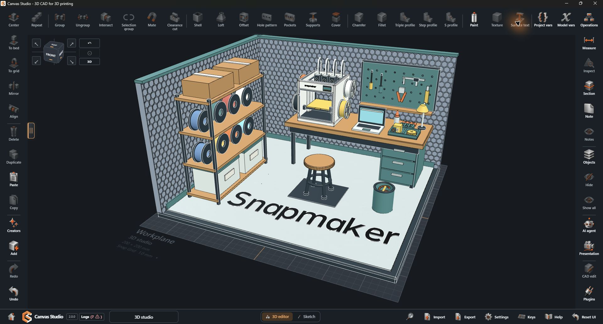
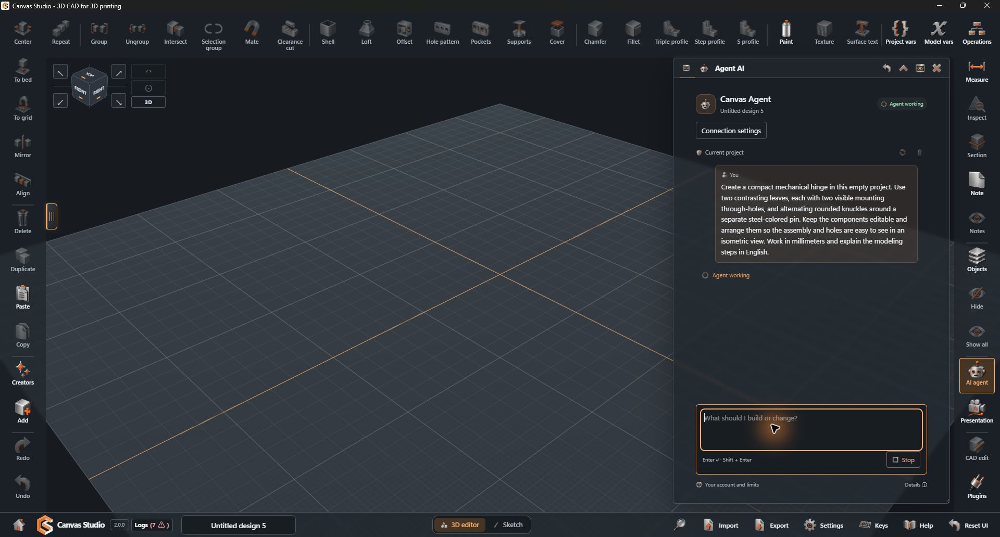
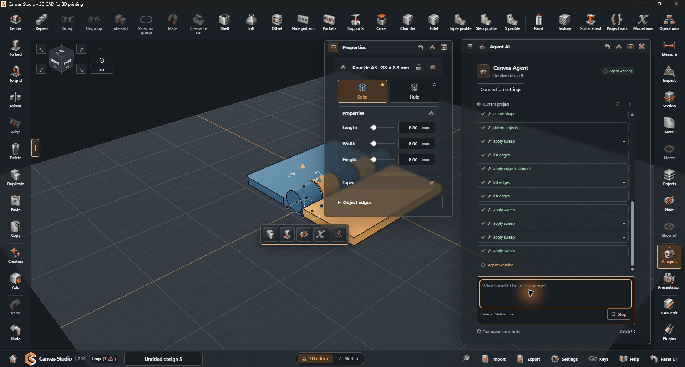
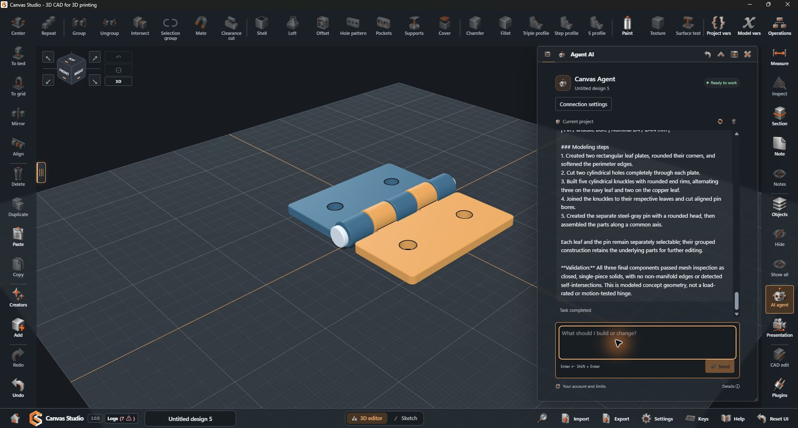
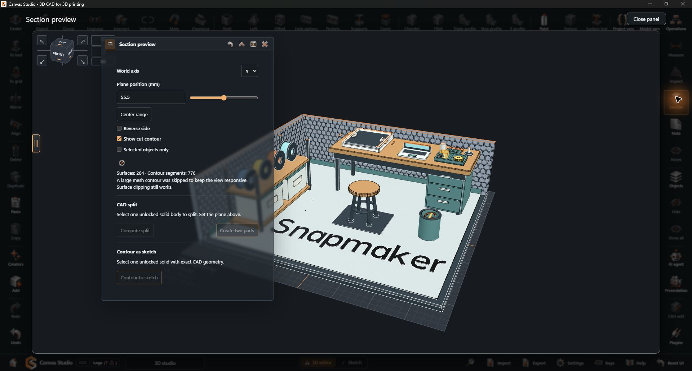
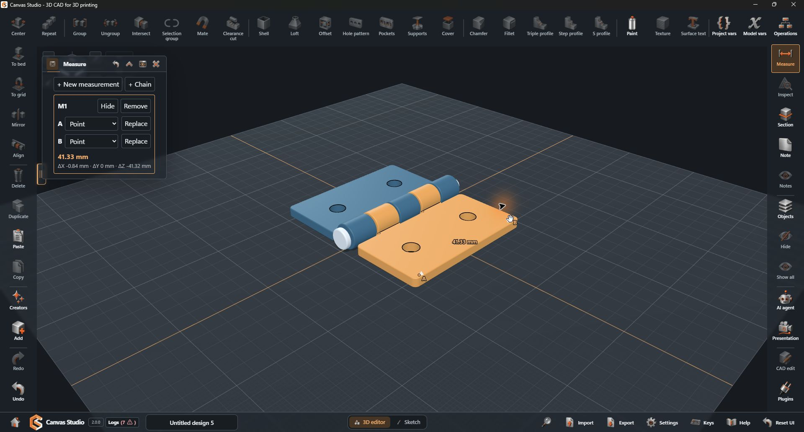
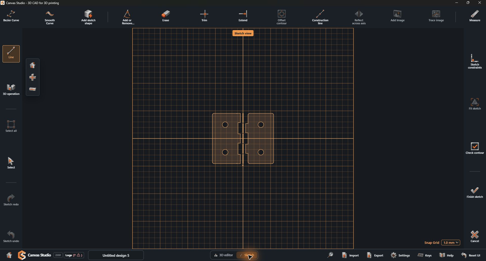
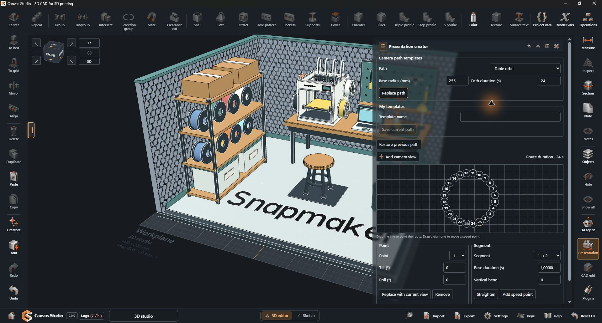
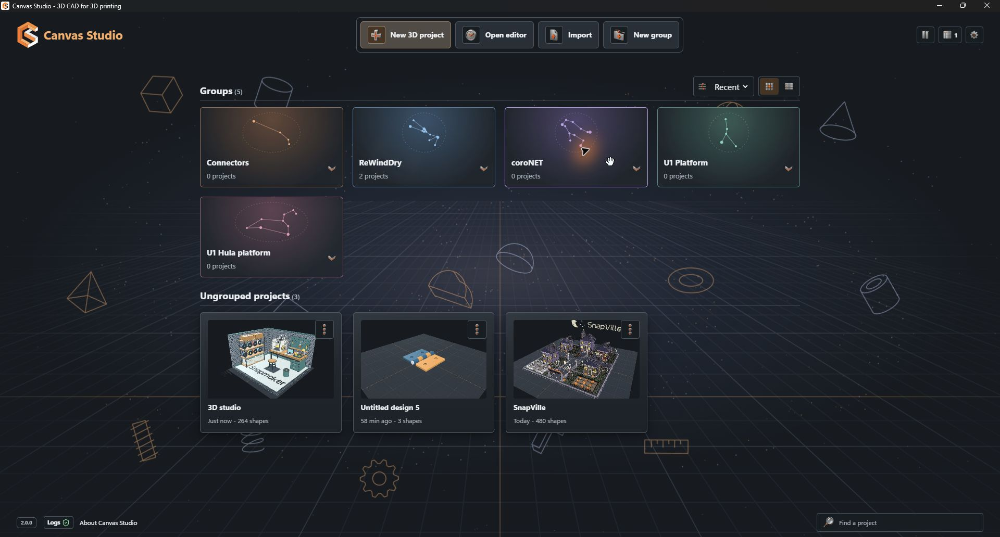

# Canvas Studio

**Free 3D design software for Windows and Linux that works offline.**

Canvas Studio gives makers and 3D printing enthusiasts a workspace for designing parts that need to fit. Start with the familiar ease of Tinkercad and use more precise tools as your design takes shape.

1. **Build with simple shapes.** Drop boxes, cylinders, and other shapes onto the workplane. Combine them into one body, or turn a shape into a hole to subtract it from another. For example, start a mounting bracket with two boxes and use cylinders to cut the screw holes.
2. **Get the dimensions and placement right.** Enter exact sizes, snap parts to the grid, align or mirror them, and use linear or circular repeats for evenly spaced features. Use a 2D sketch and extrude it when you need a custom profile. Measure between points, edges, or faces and use a live section to check clearances inside the model.
3. **Finish the part.** Chamfer edges for a beveled finish or round them with fillets. Add surface text, paint, or a relief texture where it suits the design. Save the editable project, then export STL or 3MF for slicing, or STEP for further CAD work when the geometry supports it.

**[Try Canvas Studio in your browser](https://alphastudiode.github.io/CanvasStudio/)** · **[Windows and Linux downloads and release notes](https://github.com/AlphaStudioDE/CanvasStudio/releases)** · [Po polsku](#canvas-studio-po-polsku)

### Install Canvas Studio on Android

Open Canvas Studio in Chrome. Tap **⋮ → Install app**, or **⋮ → Install and create shortcut → Install**. Then open Canvas Studio from its home screen icon to use it without the browser address bar. [Open Canvas Studio](https://alphastudiode.github.io/CanvasStudio/)

## Canvas Studio in action

### 3D modeling workspace

A complete miniature workshop with a 3D printer, filament racks, tools, and textured walls, open in the Canvas Studio editor.

### Build a hinge with Canvas Agent

Start with an empty project and describe the part in English. The agent builds two contrasting hinge leaves with four mounting holes, alternating knuckles, and a separate pin.

| Prompt in an empty project | Modeling in progress |
| --- | --- |
|  |  |

### Inspect, measure, and sketch

| Section preview | Point-to-point measurement | 2D sketch workspace |
| --- | --- | --- |
|  |  |  |

### Create a video presentation

The presentation editor shows the workshop alongside an editable camera route, with numbered viewpoints and controls for individual segments.

### Browse projects

Group related designs and find recent projects through their thumbnails.

### AI, drawing reconstruction, and presentation

| Workflow | In Canvas Studio |
| --- | --- |
| **Build with an AI agent inside the editor** | Describe what you want to create or change. The integrated agent works on the active project, so you can inspect and refine the result in the same workspace. Supported integrations include Codex, Gemini and GitHub Copilot. Account and service requirements depend on the provider. |
| **Reconstruct models from technical drawings** | Review dimensions read by OCR and confirm how supported dimensions map to the geometry. You stay in control when the drawing is ambiguous. |
| **Direct and record a model presentation** | Place camera viewpoints, bend the flight path and adjust the pace along individual segments. Choose from 20 built-in paths, including table orbits, descending spirals and inward or outward vortices. Save your own templates and record a clean view of the model. |
| **Organize and extend your workspace** | Organize projects into groups. The Windows installer includes SDK examples for plugins and custom Creators panels. |

The desktop app keeps your project library on your machine. Optional AI integrations connect to the provider you choose.

## Canvas Studio po polsku

**Canvas Studio to całkowicie darmowy program do projektowania 3D na Windows i Linuksa, który działa offline.** Zacznij tak prosto jak w Tinkercadzie, a po dokładniejsze narzędzia sięgaj w miarę rozwoju projektu.

1. **Zbuduj model z prostych brył.** Umieść prostopadłościany, walce i inne kształty na płaszczyźnie roboczej. Łącz je w jedną bryłę albo oznacz kształt jako otwór, żeby odjąć go od innego. Na przykład wspornik możesz złożyć z dwóch prostopadłościanów, a walcami wyciąć otwory na śruby.
2. **Dopasuj wymiary i położenie.** Wpisuj dokładne wymiary, korzystaj z przyciągania do siatki, wyrównuj i odbijaj elementy. Powtórzenia liniowe i kołowe pomagają zachować równe odstępy. Własny obrys narysuj w szkicu 2D i wyciągnij go do bryły. Sprawdź odległości między punktami, krawędziami lub powierzchniami, a wnętrze modelu obejrzyj w podglądzie przekroju.
3. **Dopracuj i zapisz projekt.** Fazuj lub zaokrąglaj krawędzie. Dodaj napis na powierzchni, kolor albo fakturę reliefową. Zapisz edytowalny projekt, a następnie wyeksportuj STL lub 3MF do slicera albo STEP do dalszej pracy w CAD, jeśli geometria na to pozwala.

- **Agent SI w edytorze.** Opisz, co chcesz stworzyć lub poprawić. Agent pracuje na aktywnym projekcie, a wynik możesz obejrzeć i dopracować w tym samym edytorze. Dostępne integracje obejmują Codexa, Gemini i GitHub Copilota.
- **Od rysunku technicznego do modelu.** OCR odczytuje oznaczenia wymiarów. Możesz sprawdzić odczyt i zatwierdzić przypisanie obsługiwanych wymiarów do geometrii.
- **Prezentacja i nagrywanie.** Wyznacz punkty kamery, wygnij trasę i zmień tempo na poszczególnych odcinkach. Do wyboru jest 20 tras, m.in. pełne orbity, spirale i wiry. Własne trasy możesz zapisać jako szablony.

**[Otwórz Canvas Studio w przeglądarce](https://alphastudiode.github.io/CanvasStudio/)** · **[Wydania na Windows i Linuksa](https://github.com/AlphaStudioDE/CanvasStudio/releases)**

### Zainstaluj Canvas Studio na Androidzie

Otwórz Canvas Studio w Chrome. Wybierz **⋮ → Zainstaluj aplikację** lub **⋮ → Zainstaluj i utwórz skrót → Zainstaluj**. Potem uruchom Canvas Studio z ikony na ekranie głównym, aby korzystać z edytora bez paska adresu przeglądarki. [Otwórz Canvas Studio](https://alphastudiode.github.io/CanvasStudio/)

---

Created by Damian Borkowski · AlphaStudioDE
